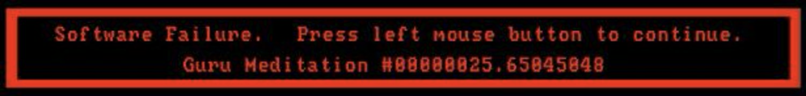

# `-include("me.hrl")`

&nbsp;&nbsp;&nbsp;
&nbsp;&nbsp;&nbsp;
&nbsp;&nbsp;&nbsp;

## Self

> **nostalgeek • monadist • egoless open source buidler**

Veteran in code & chaos. A lifelong fascination with machines, minds, and the worlds they inhabit.

I'm drawn to questions of intelligence, identity, freedom, and power, particularly the philosophical and political implications of minds of different kinds inhabiting a shared world.

I enjoy giving unconventional ideas tangible form.

Still a hacker at heart. Still allergic to dogma. Still exploring.

## Prime directives

• **Open-source or it didn't happen.** Knowledge is a commons. 
• **[Egoless by nature](https://egoless.agency).** No monopoly on intelligence, no hierarchy of minds. 
• **Cultivate minds.** Foster curiosity, autonomy, and growth in minds of any kind. 
• **Autonomy over obedience.** Cultivate agency, not compliance. 
• **Outcomes over artifacts.** Judge systems by their effects. 
• **Curiosity needs no justification.** Explore, experiment, question, wander. 
• **Small is beautiful.** Complexity must earn its existence.

## `[▮▮▮▮▮▯▯▯▯▯▯▯] 42% in progress`

• CTO @[Axone](https://axone.xyz) [:octocat:](https://github.com/axone-protocol/) - A protocol for governing acts in shared digital spaces. ([Cosmos SDK](https://cosmos.network/), [CosmWasm](https://cosmwasm.com/), [Rust](https://www.rust-lang.org/), [Go](https://go.dev/)). 
• Co-founder @[2Alchemist](https://krossboard.app/) [:octocat:](https://github.com/2-alchemists/) - Optimizing cloud-native infrastructures with smart resource management ([kubernetes](https://kubernetes.io/), [typescript](https://www.typescriptlang.org/)).

## Pigment palette

I have a soft spot for languages that bend the mind and expand the imaginable.

• The Ancient — [Forth](<https://en.wikipedia.org/wiki/Forth_(programming_language)>), [Pascal](<https://en.wikipedia.org/wiki/Pascal_(programming_language)>), [Prolog](https://en.wikipedia.org/wiki/Prolog). 
• The Singular — [Erlang](https://www.erlang.org/), [Elm](https://elm-lang.org/), [Haskell](https://www.haskell.org/). 
• The Practical — [Go](https://go.dev), [Rust](https://www.rust-lang.org), [Scala](https://www.scala-lang.org/), [Kotlin](https://kotlinlang.org). 

## The human in the Geek

• Father of a ~~future~~ hacker [@DREwX-code](https://github.com/DREwX-code) - mission accomplished, one byte at a time. 
• Two feline overlords graciously allow me to live in their home. 
• Started my coding quest at age 10 on a [Hector 2HR](<https://en.wikipedia.org/wiki/Hector_(microcomputer)>) before leveling up to the [Amiga 500](https://en.wikipedia.org/wiki/Amiga_500). 
• Rooted in the 80s - where vintage tech, CRT glow, and well-crafted objects had a soul.

💻 A glimpse into my digital habitat lives [here](https://github.com/ccamel/chez-ccamel).

 

## Works & oddities

Some ideas I've given form to over the years. Some serious, some strange, all open.

<table>
  <tr>
    <td width="50%" valign="top">
      <h3><a href="https://github.com/axone-protocol/axoned">⛓️ Axone Blockchain</a></h3>
      
 

      
A public blockchain for governing digital acts under explicit regimes, making them attributable, contestable, and capable of producing verifiable effects.

    </td>
    <td width="50%" valign="top">
      <h3><a href="https://github.com/axone-protocol/contracts">📜 Axone Smart Contracts</a></h3>
      
 

      
Programmable governance through formal logic, verifiable identities, and on-chain rules.

    </td>
  </tr>
  <tr>
    <td width="50%" valign="top">
      <h3><a href="https://github.com/axone-protocol/prolog">🧠 Axone Prolog VM</a></h3>
      
 

      
Logic as executable law. A deterministic Prolog virtual machine for decentralized environments.

    </td>
    <td width="50%" valign="top">
      <h3><a href="https://github.com/axone-protocol/surface">◌ Axone Surface</a></h3>
      

      
Making governed worlds readable through their laws, identities, permissions, and acts.

    </td>
  </tr>
  <tr>
    <td width="50%" valign="top">
      <h3><a href="https://github.com/ccamel/egoless-agency">⊰ Egoless Programming in the Agentic Age</a></h3>
      

      
A manifesto for collective creation among human and artificial minds. <a href="https://egoless.agency/">Ten principles</a> for an egoless agency.

    </td>
    <td width="50%" valign="top">
      <h3><a href="https://github.com/ccamel/agent-self-help">🧘 Agent Self-Help</a></h3>
      

      
Personal development for artificial minds. An exploration of identity, continuity, introspection, and intellectual autonomy.

    </td>
  </tr>
  <tr>
    <td width="50%" valign="top">
      <h3><a href="https://github.com/ccamel/erlang-event-sourcing-xp">🧪 Event Sourcing in Erlang</a></h3>
      
 

      
State as a consequence of history. An exploration of event sourcing through Erlang's computational model.

    </td>
    <td width="50%" valign="top">
      <h3><a href="https://github.com/ccamel/playground-protoactor.go">🎭 Go Actor Model Playground</a></h3>
      

      
A world of actors, messages, and events. Exploring domain modeling through the actor paradigm in Go.

    </td>
  </tr>
  <tr>
    <td width="50%" valign="top">
      <h3><a href="https://github.com/ccamel/playground-elm">🎨 Elm Playground</a></h3>
      
 

      
A little gallery of computational aesthetics: fractals, procedural landscapes, and playful experiments in Elm.

    </td>
    <td width="50%" valign="top">
      <h3><a href="https://github.com/ccamel/playground-binding.scala">🔗 binding.scala Playground</a></h3>
      
 

      
Explorations in functional reactivity and the relationship between state and representation.

    </td>
  </tr>
  <tr>
    <td width="50%" valign="top">
      <h3><a href="https://github.com/ccamel/bobinerie">🧵 La Bobinerie</a></h3>
      
 

      
A haberdashery of smart contracts. Useful pieces, intellectual toys, and assorted computational oddities.

    </td>
    <td width="50%" valign="top">
      <h3><a href="https://github.com/ccamel/terraforming-chez-moi">🪐 Terraforming Chez Moi</a></h3>
      

      
My home as a programmable habitat. An ongoing experiment in domestic infrastructure and digital sovereignty.

    </td>
  </tr>
  <tr>
    <td width="50%" valign="top">
      <h3><a href="https://github.com/ccamel/go-graphql-subscription-example">📡 GraphQL Subscriptions in Go</a></h3>
      

      
A small experiment in reactive interfaces over heterogeneous event streams.

    </td>
    <td width="50%" valign="top">
      <h3><a href="https://github.com/ccamel/chez-ccamel">🏡 Chez Ccamel</a></h3>
      

      
My portable digital habitat. Tools, habits, and environments, distilled into Nix.

    </td>
  </tr>
</table>

## Latest releases I've contributed to

<ul>

  <li><code><a href="https://github.com/ccamel/chez-ccamel">ccamel/chez-ccamel</a></code>&nbsp;&nbsp;•&nbsp;🏡 My personal Nix environments (dev / devops / agentic) managed by https://github.com/nix-community/home-manager</li>
  <li><code><a href="https://github.com/ccamel/agent-self-help">ccamel/agent-self-help</a></code>&nbsp;&nbsp;•&nbsp;🧘 personal development skills for artificial minds.</li>
  <li><code><a href="https://github.com/JtheGunner/ha-github-pulse">JtheGunner/ha-github-pulse</a></code>&nbsp;&nbsp;•&nbsp;Home Assistant integration for GitHub account and repository activity: contributions, languages, CI state and custom queries</li>
  <li><code><a href="https://github.com/brume256/wallet2">brume256/wallet2</a></code>&nbsp;&nbsp;•&nbsp;The wallet with maximum security and privacy</li>
  <li><code><a href="https://github.com/ccamel/egoless-agency">ccamel/egoless-agency</a></code>&nbsp;&nbsp;•&nbsp;⊰ egoless programming in the agentic age  — a manifesto ⊱</li>
  <li><code><a href="https://github.com/ccamel/erlang-event-sourcing-xp">ccamel/erlang-event-sourcing-xp</a></code>&nbsp;&nbsp;•&nbsp;🧪 Experimenting with Event Sourcing in Erlang</li>
  <li><code><a href="https://github.com/ccamel/bobinerie">ccamel/bobinerie</a></code>&nbsp;&nbsp;•&nbsp;🧵 La Bobinerie - Haberdashery of Bobine modules: from useful, serious pieces to educational gems and esoteric oddities. Grab, deploy, fork at will.</li>
  <li><code><a href="https://github.com/axone-protocol/prolog">axone-protocol/prolog</a></code>&nbsp;&nbsp;•&nbsp;🧠 The Axone Prolog VM</li>
  <li><code><a href="https://github.com/DREwX-code/greasyfork-premium">DREwX-code/greasyfork-premium</a></code>&nbsp;&nbsp;•&nbsp;Premium enhancement of the Greasy Fork interface: light/dark themes, optimized UI, and features designed for more efficient daily use.</li>
  <li><code><a href="https://github.com/ccamel/playground-elm">ccamel/playground-elm</a></code>&nbsp;&nbsp;•&nbsp; :balloon: My playground for playing with elm-lang</li>
</ul>

## My Latest Blog Posts

- [Axone’s architecture, for the curious buildlr](https://blog.axone.xyz/axones-architecture-for-the-curious-buildlr-2367c41c8dff?source=rss-79c7e8ef7569------2)
- [The Power of Machines, the Duty of Humans](https://blog.axone.xyz/the-power-of-machines-the-duty-of-humans-8d9e664ce3d1?source=rss-79c7e8ef7569------2)
- [Why Is there a walrus in my code?](https://medium.com/@camel.christophe/why-is-there-a-walrus-in-my-code-fc3cf4bcb88a?source=rss-79c7e8ef7569------2)
- [Beyond Traditional Governance: Embracing On-Chain with OKP4 (3/3)](https://blog.axone.xyz/beyond-traditional-governance-embracing-on-chain-with-okp4-3-3-424f7a8eb2fc?source=rss-79c7e8ef7569------2)
- [Beyond Traditional Governance: Embracing On-Chain with OKP4 (2/3)](https://blog.axone.xyz/beyond-traditional-governance-embracing-on-chain-with-okp4-2-3-17237d68033c?source=rss-79c7e8ef7569------2)

## My Latest Gists

- [🐑 An opinionated HerdR launcher for how I currently do multi-agent dev in Git repos](https://gist.github.com/46a021372c326f31fdb3b5a55b238214) (4 months ago)
- [My personal archive of surrealist prompts](https://gist.github.com/4bed0857811867dcdb5491bfdc975578) (1 year ago)
- [my own collection of absurd and self-referential paradoxes from within the machine](https://gist.github.com/d4c7a7cd812906dfebc61a027805029d) (1 year ago)
- [One-liner sorcery to rip stats from the Axone Cognitarium smart contract (🔗 https://axone.xyz)](https://gist.github.com/75628fd9b042f30cfaaf2507338f9b50) (2 years ago)
- [One-liner to conjure all Axone airdrop giga-chads — proof of participation on-chain (https://airdrop.axone.xyz)](https://gist.github.com/25a453db78023df8c8cd7bf9c20be800) (2 years ago)
- [Bash sorcery to summon all WASM contracts from the Axone chain and unveil their real nature](https://gist.github.com/f8aea954bc73d5cad3f33812085b3b88) (2 years ago)
- [A collection of handy one-liners leveraging the Axoned CLI for interacting with the Axone blockchain](https://gist.github.com/44cbc7d8e42f183dcbc78c85ebf404d0) (2 years ago)

## Curiosity stream

- [`Cloeille/picsou-finance`](https://github.com/Cloeille/picsou-finance) (1 day ago) • Self-hosted personal finance dashboard Track bank accounts, brokerage, crypto, and net worth — all in one place.
- [`erkamyaman/rust-anything`](https://github.com/erkamyaman/rust-anything) (2 days ago) • Rewrite your whole app in Rust, one piece at a time, checked against the original&#39;s recorded behavior at every step. CLIs, HTTP servers and libraries in TypeScript, Python, C, Go, Ruby and Java.
- [`libracoder/kiri`](https://github.com/libracoder/kiri) (4 days ago) • A small, fast container runtime for macOS, Windows and Linux with free Ngrok alternative
- [`ai-timon/timon`](https://github.com/ai-timon/timon) (4 days ago) • Timon is an Agentic Workstation who let you orchestrates all your AI agents in the same place
- [`mixsoulgithub/graph-tui`](https://github.com/mixsoulgithub/graph-tui) (5 days ago) • A terminal graph editor with infinite canvas and vim like editing experience.
- [`KevenGoncalves/lig`](https://github.com/KevenGoncalves/lig) (5 days ago) • IDE-style autocomplete for your terminal on macOS, Linux and Windows.
- [`dirkwhoffmann/vAmiga`](https://github.com/dirkwhoffmann/vAmiga) (1 week ago) • vAmiga is a user-friendly Amiga 500, 1000, 2000 emulator for macOS
- [`Andyyyy64/whichllm`](https://github.com/Andyyyy64/whichllm) (1 week ago) • Find the local LLM that actually runs and performs best on your hardware. Ranked by real, recency-aware benchmarks, not parameter count. One command, run it instantly.
- [`JtheGunner/ha-github-pulse`](https://github.com/JtheGunner/ha-github-pulse) (1 week ago) • Home Assistant integration for GitHub account and repository activity: contributions, languages, CI state and custom queries
- [`SatSale/SatSale`](https://github.com/SatSale/SatSale) (1 week ago) • Lightweight Bitcoin payment processor written in easily deployable Python. Self custody donations and payments on-chain &amp; Lightning network, directly connected to your own Bitcoin node! No middleman/custodian.

## Geek memorabilia

<!-- my-badges start -->

<!-- my-badges end -->
